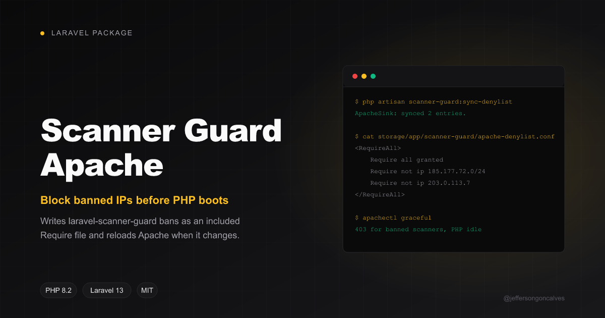

<div class="filament-hidden">



</div>

# Laravel Scanner Guard Apache

[](https://packagist.org/packages/jeffersongoncalves/laravel-scanner-guard-apache)
[](https://github.com/jeffersongoncalves/laravel-scanner-guard-apache/actions/workflows/tests.yml)
[](https://packagist.org/packages/jeffersongoncalves/laravel-scanner-guard-apache)

Apache denylist sink for [`laravel-scanner-guard`](https://github.com/jeffersongoncalves/laravel-scanner-guard).
Writes every banned IP and `ip_blocklist` entry as an Apache `Require not ip` line, so banned scanners
get a `403` from Apache before PHP boots. Requires Apache 2.4.

```apache
<RequireAll>
	Require all granted
	# static
	Require not ip 185.177.72.0/24
	# scanner_path, expires 2026-11-20T10:00:00+00:00
	Require not ip 203.0.113.7
</RequireAll>
```

## Installation

```bash
composer require jeffersongoncalves/laravel-scanner-guard-apache
```

Add the sink to `config/scanner-guard.php`:

```php
'sinks' => [
    \JeffersonGoncalves\ScannerGuardApache\ApacheSink::class,
],
```

Include the file at the **end** of your virtual host:

```apache
<VirtualHost *:443>
    # ...

    <Location "/">
        AuthMerging And
        IncludeOptional /var/www/html/storage/app/scanner-guard/apache-denylist*.conf
    </Location>
</VirtualHost>
```

- Keep `AuthMerging And`: without it, the list's `Require all granted` **replaces** your own rules, so
  it would open directories you denied or password-protected. With it, both must pass. A
  `Require all granted` in an `.htaccess` can't undo a ban either.
- Keep it after any other `<Location>` that has a `Require`: a later one replaces the denylist for its
  path.
- Keep the `*` and `IncludeOptional`: Apache then starts even before the file exists.

`scanner-guard:sync-denylist` now runs every minute, and right after every ban, unban and blocklist
change (see the core README's "Blocking before PHP" section).

## Configuration

```bash
php artisan vendor:publish --tag="laravel-scanner-guard-apache-config"
```

| Key | Env | Default | |
|---|---|---|---|
| `path` | `SCANNER_GUARD_APACHE_PATH` | `storage/app/scanner-guard/apache-denylist.conf` | relative to `base_path()` |
| `reload_command` | `SCANNER_GUARD_APACHE_RELOAD_COMMAND` | `null` | e.g. `sudo apachectl graceful` |

The file is only rewritten when its content changes, through a temp file renamed over the target,
so Apache never reads a half-written list. Apache only re-reads an included file on reload: the
`reload_command` runs after a write, never otherwise. A non-zero exit or a timeout is logged, never
thrown. The PHP user (and your queue worker, if different) must be allowed to run it without a
password, e.g. in `/etc/sudoers.d/scanner-guard`:

```
www-data ALL=NOPASSWD: /usr/sbin/apachectl graceful
```

In a container where PHP can't signal Apache, leave the command empty and let a root process run
`apachectl graceful` when the file's mtime changes.

Shared hosting without access to the virtual host isn't supported: `<Location>` isn't allowed in an
`.htaccess`.

### Behind a proxy or CDN

`Require ip` matches the connecting address. Behind Cloudflare or a load balancer, that is the
proxy's IP unless `mod_remoteip` restores the client IP first with `RemoteIPHeader`
(`CF-Connecting-IP` for Cloudflare) and `RemoteIPTrustedProxy`, trusting only the proxy's ranges.
Otherwise the denylist never matches a visitor.

## Testing

```bash
composer test
```

## Changelog

Please see [CHANGELOG](CHANGELOG.md) for more information on what has changed recently.

## Credits

- [Jefferson Gonçalves](https://github.com/jeffersongoncalves)
- [All Contributors](../../contributors)

## License

The MIT License (MIT). Please see [License File](LICENSE.md) for more information.
